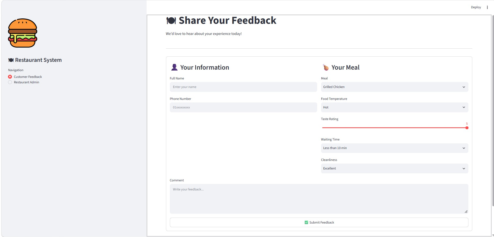
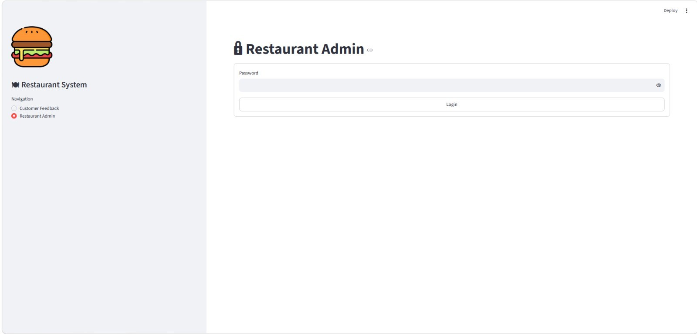
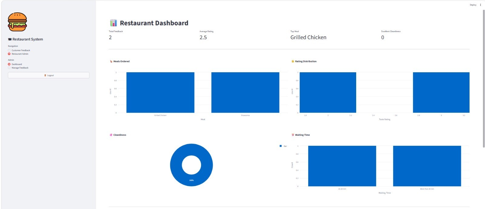
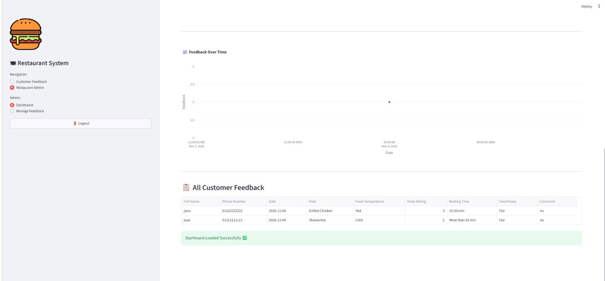
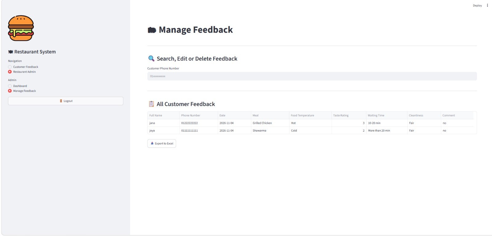
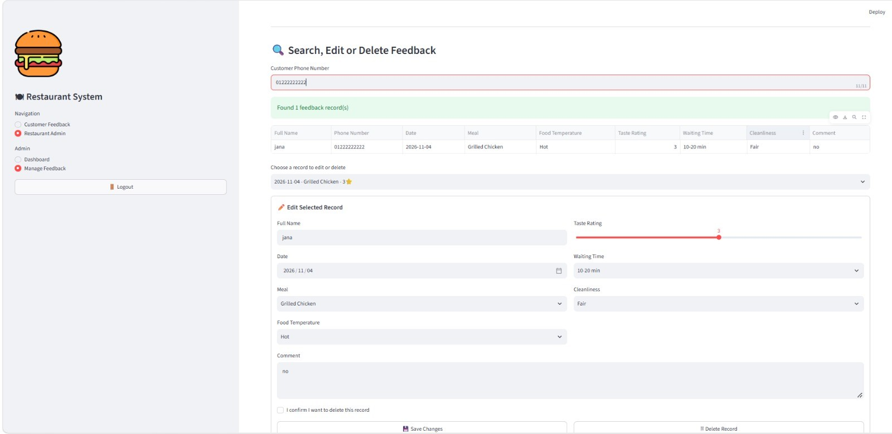

# Restaurant Feedback System

A web-based restaurant feedback system that enables customers to submit feedback while providing an interactive dashboard for feedback analysis.

## Features
**Customer page**
- Simple feedback form with input validation (Egyptian mobile numbers)
- Customers only see the form, never other customers' data

**Restaurant admin (password protected)**
- Interactive analytics dashboard
- Search a customer's feedback by phone number
- Edit or delete a single feedback record (with delete confirmation)
- Export all feedback to Excel
- Data stored in an Excel file (`feedback.xlsx`, created automatically on first run)

## Technologies Used
- Python
- Streamlit
- Pandas
- Plotly
- OpenPyXL

## Project Structure
- `app.py` – customer feedback form, admin login, and feedback management
- `database.py` – reading, writing and validating data in the Excel file
- `dashboard.py` – KPIs and charts

## How to Run

1. Install the required libraries:
```bash
pip install -r requirements.txt
```

2. Set the admin password: create a file named `secrets.toml` inside a folder named `.streamlit` in the project folder, with this line:
```toml
admin_password = "choose-a-strong-password"
```
This file is listed in `.gitignore`, so the password is never uploaded to GitHub.

3. Run the application:
```bash
python -m streamlit run app.py
```

## Screenshots

### Customer Feedback Form
Customers only see this form.


### Admin Login
The restaurant area is protected by a password.


### Dashboard


### Dashboard (Feedback Over Time & All Records)


### Manage Feedback


### Search & Edit a Record


## Author
Karim Reda
